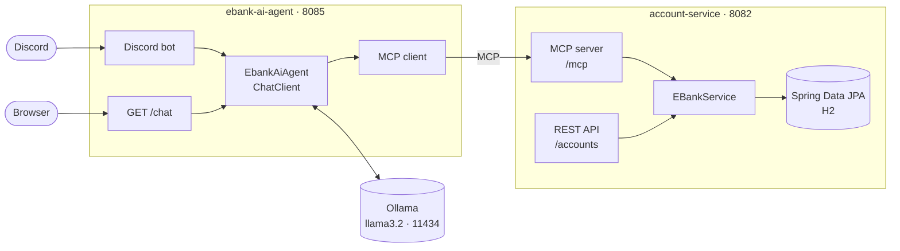

<div align="center">

# eBank — Agentic Microservice

**Natural-language e-banking.**
A Spring Boot microservice exposes banking operations as **MCP** tools;
a local LLM agent uses them to manage accounts over **REST** and **Discord**.


<br>


</div>

---

## Overview

> *"Credit 500 MAD to customer 1's current account."*
> The agent picks the `credit` tool, calls it over MCP and answers in plain language.

| Module | Role |
| --- | --- |
| **account-service** | Accounts & transactions (JPA + H2), REST API with Swagger, MCP server |
| **ebank-ai-agent** | MCP client + Spring AI `ChatClient` on Ollama, with chat memory, exposed over REST and Discord |

Business logic lives in a single place: `EBankService` is shared by the REST API and the MCP server.

## Architecture



## MCP tools

| Tool | Description |
| --- | --- |
| `getAllAccounts` | List all accounts |
| `getAccountById` | Get one account |
| `getAccountsByCustomer` | List a customer's accounts |
| `saveNewAccount` | Open a `CURRENT_ACCOUNT` or `SAVING_ACCOUNT` |
| `credit` | Credit an account |
| `debit` | Debit an account (balance checked) |

Each tool is a method annotated with `@McpTool`; its parameters are described with `@McpToolParam`.

## Getting started

**Requirements:** JDK 17, Maven, [Ollama](https://ollama.com), a Discord bot (optional).

All three components run **at the same time**, started in this order:

```bash
# 1. Local LLM
ollama serve
ollama pull llama3.2

# 2. Microservice + MCP server (wait for "Started AccountServiceApplication")
cd account-service && ./mvnw spring-boot:run

# 3. AI agent (connects to the MCP server on startup)
cd ebank-ai-agent && ./mvnw spring-boot:run
```

On Windows, use `mvnw.cmd` instead of `./mvnw`.

### Discord bot

```properties
# ebank-ai-agent/src/main/resources/application.properties
discord.token=${DISCORD_TOKEN}
discord.gateway-intents=GUILD_MESSAGES,DIRECT_MESSAGES,MESSAGE_CONTENT
```

Set the `DISCORD_TOKEN` environment variable, and enable **Message Content Intent** under *Bot* in the Discord Developer Portal.

## Endpoints

| Service | URL |
| --- | --- |
| Accounts | http://localhost:8082/accounts |
| Accounts by customer | http://localhost:8082/accounts?customerId=1 |
| Swagger UI | http://localhost:8082/swagger-ui/index.html |
| H2 console | http://localhost:8082/h2-console — JDBC `jdbc:h2:mem:account-db`, user `sa` |
| MCP server | http://localhost:8082/mcp |
| AI agent | http://localhost:8085/chat?query=list%20accounts%20of%20customer%201 |

## Project structure

```
ebank-bdcc-app/
├── pom.xml                       # Parent POM
├── account-service/
│   └── src/main/java/net/aouchar/accountservice/
│       ├── domain/               # JPA entities & enums
│       ├── repository/           # Spring Data JPA
│       ├── service/              # EBankService
│       ├── rest/                 # REST controller
│       ├── mcp/                  # MCP tools
│       └── exceptions/
└── ebank-ai-agent/
    └── src/main/java/net/aouchar/ebankaiagent/
        ├── agents/               # EbankAiAgent
        ├── rest/                 # GET /chat
        └── discord/              # Discord controller
```
